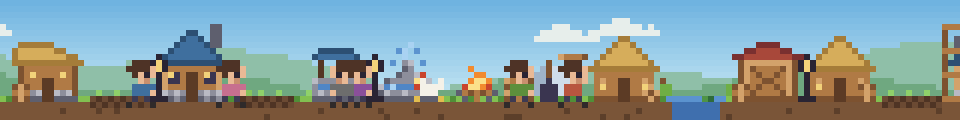
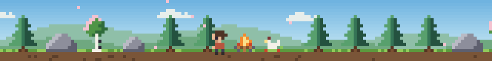
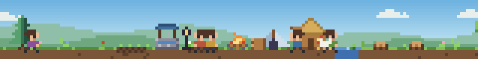
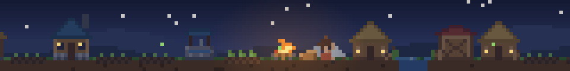
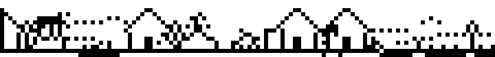
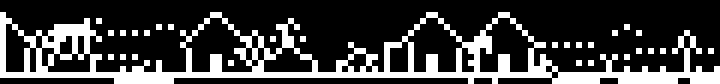
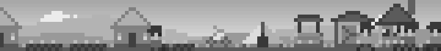

# WorkVillage

**在 Claude Code 輸入框上方，打造一座隨專案進度成長的像素風小村莊。**

[English](README.md) | 繁體中文



每個專案都從未開墾的荒野開始：森林中只有一位拓荒者和一堆營火。
隨著你與 Claude 推進開發，村民會走出營地伐木、採石、耕種與興建房舍，
營地將逐步發展為聚落、村莊、城鎮，最終成為城市。

| 荒野 | 聚落 | 夜晚 |
| --- | --- | --- |
|  |  |  |

## 安裝

在 Claude Code 終端機工作階段的輸入框中執行：

```
/plugin install workvillage --marketplace JimmyCodeWork/WorkVillage
```

輸入 `y` 新增 marketplace，再選擇安裝範圍。亦可在 shell 中執行：

```
claude plugin install workvillage --marketplace JimmyCodeWork/WorkVillage
```

使用桌面版時，請點選輸入框旁的 **+**，選擇 **Plugins**，以 **Add marketplace** 加入
`JimmyCodeWork/WorkVillage` 後，再點選 **Add plugin**。

需要 Claude Code 2.1.275 或更新版本。

## 開發活動如何影響村莊

| 工作階段中的行為 | 村民的動作 |
| --- | --- |
| 編輯檔案 | 伐木或清除樹樁以取得**木材**，或推進目前的建設 |
| 新增檔案 | 開採岩石以取得**石材** |
| 讀取或搜尋檔案 | 累積**知識**，並不時採集糧食 |
| 測試通過 | 播種、澆水與收成，取得**糧食** |
| `git commit` 成功 | 里程碑：大幅推進目前的建設 |
| 完成待辦事項或任務 | 若有空房，將有新村民加入 |

建築依序為：帳篷、茅屋、水井、倉庫、民宅、工坊與瞭望塔。
每棟建築需消耗木材與石材，並經過數個施工階段才會落成。營地附近的樹木伐盡後，
開墾範圍會向森林延伸。天色會依照本機時間變化，入夜後村民會圍坐在營火旁。

工具呼叫失敗不會造成任何損失：村莊只會持續成長。

## 指令

| 指令 | 說明 |
| --- | --- |
| `/village` | 開啟村莊面板，檢視資源與開發活動 |
| `/village show` / `/village hide` | 顯示或隱藏輸入框上方的村莊 |
| `/village stats` | 列出村莊資源與開發活動統計 |
| `/village settings` | 開啟設定面板 |
| `/village reset confirm` | 將此專案的村莊重置為荒野 |

## 設定

點選村莊右下角的「**設定**」，或執行 `/village settings`，即可開啟設定面板（亦可在此隱藏或顯示村莊），
變更會立即套用。相同的設定也可在 `/config` 選單的 **workvillage** 項目下調整。

| 設定 | 可用值 | 預設值 |
| --- | --- | --- |
| `size` | `small`（7 列高、最寬 120 欄）、`medium`（10 列高、全寬，並附摘要列） | `small` |
| `palette` | `color`、`grayscale`、`mono`、`mono-light`、`mono-dark` | `color` |
| `pixel` | `small`、`medium`、`large`（說明如下） | `small` |
| `language` | `auto`、`en`、`zh-TW` | `auto`（依 `LC_ALL`、`LC_MESSAGES` 或 `LANG` 判斷） |
| `animation` | `full`、`reduced`、`off` | `full` |

### 黑白模式

`mono` 系列以黑白線稿呈現村莊，並提供明、暗兩種版本：

| 設定值 | 外觀 |
| --- | --- |
| `mono` | 沿用終端機本身的文字色與背景色，淺色與深色主題皆適用；其他介面為明亮版 |
| `mono-light` | 白底黑線（明亮版） |
| `mono-dark` | 黑底白線（暗色版） |

`grayscale` 則以灰階保留所有明暗層次。

| `mono-light` | `mono-dark` |
| --- | --- |
|  |  |



## 顯示位置

- **終端機**：以半格字元繪製像素場景並就地更新動畫，預設 7 列高，`medium` 尺寸為 10 列高。終端機高度不足時，改為顯示單行摘要。
- **支援圖形的終端機（kitty、Ghostty）**：`pixel` 設為 `small` 時，以圖片繪製半尺寸像素，
  精簡尺寸僅占 4 列，且可顯示兩倍範圍的村莊。在 tmux 中則改用半格字元繪製。
- **Claude Code 桌面版**：以 SVG 呈現相同的場景；`small`、`medium`、`large` 分別為每個像素
  1.5、2、3 個 CSS 像素。
- **行動版**：可於 `/village` 面板中檢視。

## 隱私

WorkVillage 不會發出任何網路請求，也不會傳送任何遙測資料。它只記錄工作的類型
（編輯、讀取、測試通過等），絕不保存檔名、檔案內容、指令或提示詞。
各專案的村莊資料儲存在 WorkVillage 自身的外掛儲存區，並以專案根目錄區分。

## 開發

```
claude plugin validate .   # 檢查 manifest 與 hooks 模組
claude plugin test .       # 執行測試
tsc -p .                   # 型別檢查（需先由 Claude Code 載入過一次 mod）
bun scripts/preview.ts docs/images   # 產生預覽圖
```

若要測試本機修改，請以 `claude --plugin-dir /path/to/WorkVillage` 啟動 Claude Code。

### 發佈版本

版本號遵循[語意化版本](https://semver.org/lang/zh-TW/)。發佈時，請在
`.claude-plugin/plugin.json` 與 `.claude-plugin/marketplace.json` 設定相同的版本號，
於 `CHANGELOG.md` 新增對應段落，並將合併後的 commit 標記為 `vX.Y.Z`。
推送 tag 後會觸發發佈工作流程，檢查版本號並以該版本的 CHANGELOG 內容建立 GitHub Release。
亦可不推送 tag，改至 Actions 頁籤手動執行（選擇 **Release**，在 `main` 上按 **Run workflow** 並輸入版本號），
工作流程會同時在 `main` 上建立 tag 與 Release。

原始碼結構如下：

- `src/core`：村莊規則與數值平衡（純函式）
- `src/scene`：村民動畫與畫面合成
- `src/art`：調色盤、精靈圖與村民動作
- `src/pixel`：影格緩衝區，以及終端機與 SVG 的編碼器
- `src/i18n`：英文與繁體中文字串
- `hooks/register.tsx`：將 Claude Code 事件連接至村莊

## 美術素材

WorkVillage 的所有像素美術皆為本專案原創繪製，並以與程式碼相同的授權釋出，
未衍生自任何其他遊戲或素材包。

## 授權

[MIT](LICENSE)
