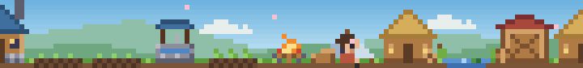
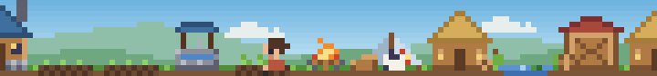
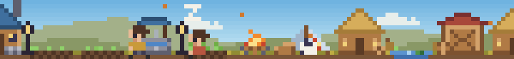

# WorkVillage

**在 Claude Code 輸入框上方，打造一座隨專案進度成長的像素風小村莊。**

[English](README.md) | 繁體中文


每個專案都從未開墾的荒野開始：森林中只有一位拓荒者和一堆營火。
隨著你與 Claude 推進開發，村民會走出營地伐木、採石、耕種與興建房舍，
營地將逐步發展為聚落、村莊、城鎮，最終成為城市。

| 荒野 | 聚落 | 夜晚 |
| --- | --- | --- |
|  |  |  |

## 安裝

在 Claude Code 終端機工作階段的輸入框中執行：

```
/plugin install workvillage --marketplace JimmyCodeWork/WorkVillage
```

輸入 `y` 新增 marketplace，再選擇安裝範圍。亦可在 shell 中執行：

```
claude plugin install workvillage --marketplace JimmyCodeWork/WorkVillage
```

使用桌面版時，請點選輸入框旁的 **+**，選擇 **Plugins**，以 **Add marketplace** 加入
`JimmyCodeWork/WorkVillage` 後，再點選 **Add plugin**。

需要 Claude Code 2.1.275 或更新版本。

## 開發活動如何影響村莊

村莊會隨著你與 Claude 一起進行的開發工作成長。編輯、撰寫、閱讀、思考、測試與提交，都會讓村民動起來：
伐木、採石、耕作與興建房屋；隨著任務完成，也會有新村民加入。你不需要為村莊做任何事，
專心推進專案，村莊就會跟著發展。

村民會把每項工作完整做完：一棵樹要砍上許多斧才會倒下，再鋸成木段；岩石則要敲到裂開、碎成石塊。
沒有工作的村民會主動協助進行中的工作；倉庫落成後，木材與石材會搬進倉庫。

建築依序為：帳篷、茅屋、水井、倉庫、民宅、工坊與瞭望塔。
每棟建築需消耗木材與石材，並經過數個施工階段才會落成。營地附近的樹木伐盡後，
開墾範圍會向森林延伸。天色會依照本機時間變化。入夜後有家的村民會回家，屋內有人時窗戶會亮起；
看守營地的村民則留在營火旁。白天村民偶爾會回家坐坐，夜裡若有工作進來，也會有人開門出來幫忙。

荒野中散布著池塘；附近沒有池塘的村莊，在蓋好幾棟建築後會自己挖一座。閒暇時，
會有村民去釣魚：浮標上下晃動、有東西咬鉤，最後把漁獲高高舉起；多半是魚，偶爾也會釣到別的東西。
釣魚絕不耽誤工作，一有工作就會收竿。

村莊裡偶爾也會發生其他事：森林裡可能爬出一隻甲蟲到處亂竄，直到村民把牠抓住；也可能有村民出門辦事，
走出視線外，稍後扛著一袋收穫回來。長時間沒有動靜時，村民會坐著打起瞌睡，直到營火旁的公雞啼叫把大家叫醒。

四季隨工作推進，而非依照日曆：數小時的工作就會走過一年，離開時季節也會暫停。
春天樹上開花，夏夜有螢火蟲，秋天落葉紛飛，冬天屋頂積雪、煙囪冒煙。目前的季節會顯示在村莊上方的資源列。

| 春 | 夏 | 秋 | 冬 |
| --- | --- | --- | --- |
|  |  |  |  |

工具呼叫失敗不會造成任何損失：村莊只會持續成長。

### 每座村莊都獨一無二

每座村莊都有自己的森林樹種與主色調，約半數建築會採用主色調。每棟建築在動工時就決定外觀：
屋頂顏色、朝向，以及旁邊的擺設，例如木桶、木箱或柴堆。新建築會蓋在營火的左右兩側，
因此每座村莊的配置都不相同。

在各專案中工作時，會陸續發現更多樣式，例如其他屋頂顏色，以及可擺在建築旁的新物件。
發現時會跳出提示，該樣式也可能出現在任一村莊之後的新建築上。`/village stats` 與 `/village` 面板
會列出已發現的樣式；至於還有哪些樣式、如何發現，就留待工作中自然遇見。

## 指令

| 指令 | 說明 |
| --- | --- |
| `/village` | 開啟村莊面板，檢視資源與開發活動 |
| `/village show` / `/village hide` | 顯示或隱藏輸入框上方的村莊 |
| `/village stats` | 列出村莊資源、開發活動統計、本裝置所有專案的累計，以及已發現的樣式 |
| `/village settings` | 開啟設定面板 |
| `/village reset confirm` | 將此專案的村莊重置為荒野 |

## 設定

村莊上方一列顯示資源，最右側為「**設定**」按鈕；點選該按鈕或執行 `/village settings`，即可開啟設定面板（亦可在此隱藏或顯示村莊），
變更會立即套用。相同的設定也可在 `/config` 選單的 **workvillage** 項目下調整。

| 設定 | 可用值 | 預設值 |
| --- | --- | --- |
| `size` | `small`（7 列高）、`medium`（10 列高）；兩者皆填滿整個寬度，並位於資源列下方 | `small` |
| `palette` | `color`、`grayscale`、`mono`、`mono-light`、`mono-dark` | `color` |
| `pixel` | `small`、`medium`、`large`（說明如下） | `small` |
| `language` | `auto`、`en`、`zh-TW` | `auto`（依 `LC_ALL`、`LC_MESSAGES` 或 `LANG` 判斷） |
| `animation` | `full`、`reduced`、`off` | `full` |

### 匯出與匯入

設定面板也可備份及移轉村莊：

- **複製此村莊**：將此專案村莊的匯出碼複製到剪貼簿。
- **複製完整備份**：複製本裝置所有村莊及累計紀錄。完整備份會包含各專案的資料夾路徑，
  以便將每座村莊還原至原專案，請勿公開分享。
- **匯入**：貼上匯出碼後按 Enter，WorkVillage 會先顯示內容摘要，確認後才會變更。
  單一村莊會取代此專案的村莊；完整備份則取代其中包含的村莊與累計紀錄。
- **復原匯入**：還原上一次匯入所取代的資料。

無法使用剪貼簿時，匯出碼會直接顯示於面板中，可手動複製。匯入需要文字輸入欄位，
因此僅能在終端機與桌面版應用程式中使用。匯出碼只包含計數與村莊配置，
不含檔名、檔案內容或指令。匯入前請先關閉同一專案的其他 Claude Code 工作階段，
否則仍開啟中的工作階段會保留自己的村莊副本，並在存檔時覆蓋匯入的內容。

### 黑白模式

`mono` 系列以黑白線稿呈現村莊，並提供明、暗兩種版本：

| 設定值 | 外觀 |
| --- | --- |
| `mono` | 沿用終端機本身的文字色與背景色，淺色與深色主題皆適用；其他介面為明亮版 |
| `mono-light` | 白底黑線（明亮版） |
| `mono-dark` | 黑底白線（暗色版） |

`grayscale` 則以灰階保留所有明暗層次。

| `mono-light` | `mono-dark` |
| --- | --- |
|  |  |


## 顯示位置

- **終端機**：以半格字元繪製像素場景並就地更新動畫，預設 7 列高，`medium` 尺寸為 10 列高。終端機高度不足時，改為顯示單行摘要。
- **支援圖形的終端機（kitty、Ghostty）**：`pixel` 設為 `small` 時，以圖片繪製半尺寸像素，
  精簡尺寸僅占 4 列，且可顯示兩倍範圍的村莊。在 tmux 中則改用半格字元繪製。
- **Claude Code 桌面版**：以 SVG 呈現相同的場景；`small`、`medium`、`large` 分別為每個像素
  1.5、2、3 個 CSS 像素。
- **行動版**：可於 `/village` 面板中檢視。

## 隱私

WorkVillage 不會發出任何網路請求，也不會傳送任何遙測資料。它只記錄工作的類型
（編輯、讀取、測試通過等），絕不保存檔名、檔案內容、指令或提示詞。
各專案的村莊資料儲存在 WorkVillage 自身的外掛儲存區，並以專案根目錄區分；
另有一份本裝置共用的累計紀錄，包含所有專案的開發活動總計與各村莊的摘要。

## 開發

```
claude plugin validate .   # 檢查 manifest 與 hooks 模組
claude plugin test .       # 執行測試
tsc -p .                   # 型別檢查（需先由 Claude Code 載入過一次 mod）
bun scripts/preview.ts docs/images   # 產生預覽圖
```

若要測試本機修改，請以 `claude --plugin-dir /path/to/WorkVillage` 啟動 Claude Code。

### 發佈版本

版本號遵循[語意化版本](https://semver.org/lang/zh-TW/)。發佈時，請在
`.claude-plugin/plugin.json` 與 `.claude-plugin/marketplace.json` 設定相同的版本號，
於 `CHANGELOG.md` 新增對應段落，並將合併後的 commit 標記為 `vX.Y.Z`。
推送 tag 後會觸發發佈工作流程，檢查版本號並以該版本的 CHANGELOG 內容建立 GitHub Release。
亦可不推送 tag，改至 Actions 頁籤手動執行（選擇 **Release**，在 `main` 上按 **Run workflow** 並輸入版本號），
工作流程會同時在 `main` 上建立 tag 與 Release。

原始碼結構如下：

- `src/core`：村莊規則與數值平衡（純函式）
- `src/scene`：村民動畫與畫面合成
- `src/art`：調色盤、精靈圖與村民動作
- `src/pixel`：影格緩衝區，以及終端機與 SVG 的編碼器
- `src/i18n`：英文與繁體中文字串
- `hooks/register.tsx`：將 Claude Code 事件連接至村莊

## 美術素材

WorkVillage 的所有像素美術皆為本專案原創繪製，並以與程式碼相同的授權釋出，
未衍生自任何其他遊戲或素材包。

## 贊助

如果你喜歡 WorkVillage，歡迎透過 Ko-fi 支持開發。感謝你幫助村莊持續成長！

<a href="https://ko-fi.com/toolmanjimmy" target="_blank"></a>

## 授權

[MIT](LICENSE)
